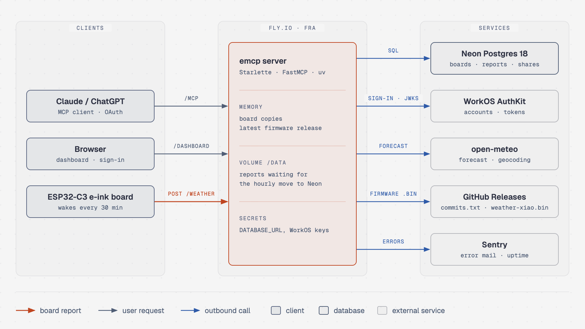
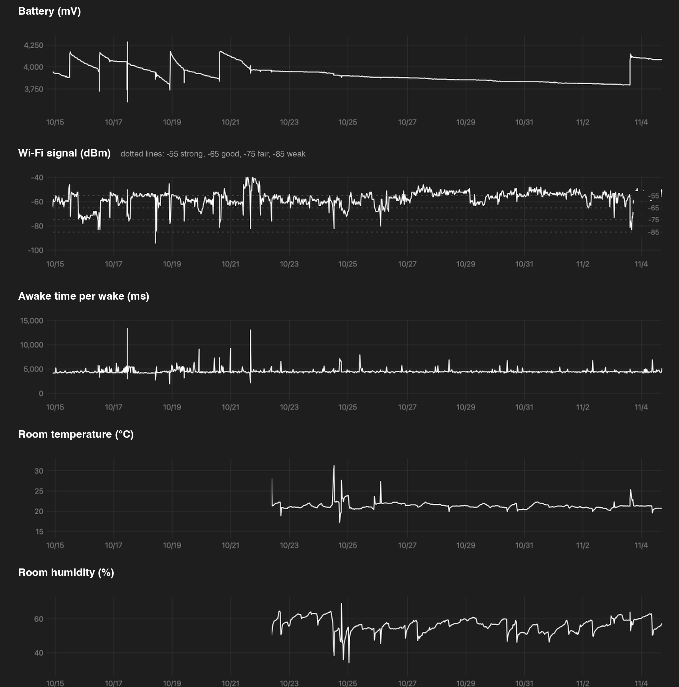
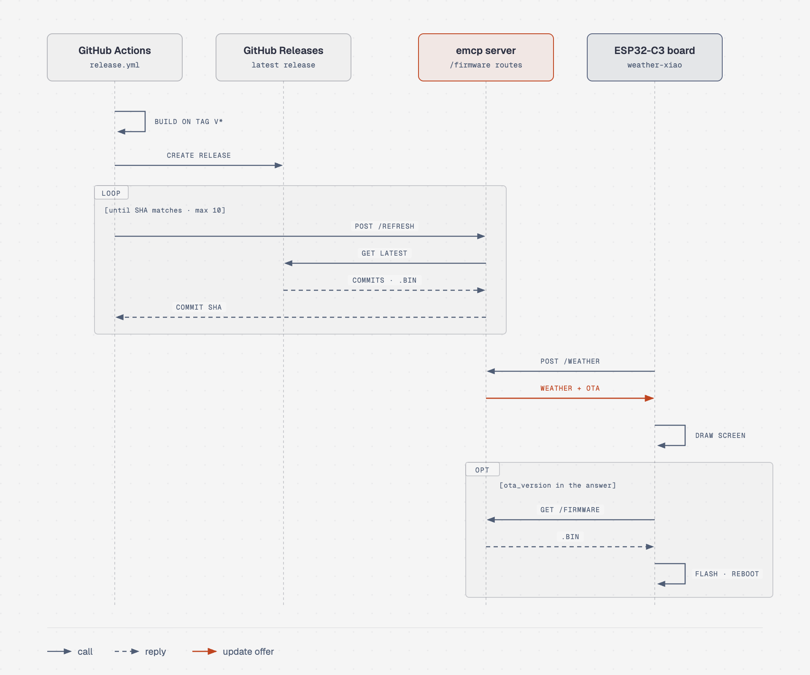

[English](README.md) | [한국어](docs/ko/README.md)

# emcp

Server for an ESP32 e-ink weather board. Each board reports its state on every wake and gets the weather for its location in the same response. Owners rename boards and change their weather location from Claude or ChatGPT over MCP, and read the reports on a web dashboard. The firmware lives in [eink-weather-display](https://github.com/seung-gu/eink-weather-display).

[](https://github.com/seung-gu/emcp/actions/workflows/deploy.yml)




Sign-in goes through WorkOS AuthKit, and every person sees only their own boards. Board registration design: [docs/multi-user-rollout.ko.md](docs/multi-user-rollout.ko.md) (Korean).

## Dashboard



`/dashboard` after sign-in (Korean UI):

- Boards: rename, change the weather location, share by email, unregister, add one with its code
- Charts: battery, Wi-Fi signal, time awake, room temperature and humidity, chip temperature, NVS use. Ranges from 6 hours to 7 days or everything, drag to zoom, times in the board's local time
- Tables: the last 50 reports, and reports the board could not send at the time

## Stack

| Area | Used | For |
|---|---|---|
| Language, packages | Python 3.12, uv | whole server, `uv.lock` |
| MCP | official `mcp` SDK, FastMCP (Streamable HTTP, stateless) | tools for Claude and ChatGPT |
| Web | Starlette, uvicorn, Jinja2 | board API, dashboard, sign-in |
| Database | Neon Postgres 18, psycopg 3 | boards, reports, sharing |
| Sign-in | WorkOS AuthKit (Staging), PyJWT | dashboard sign-in, MCP token check |
| Outbound HTTP | httpx | open-meteo, GitHub Releases |
| Weather | open-meteo (forecast and geocoding, no API key) | `/weather` answers, place search |
| Hosting | Fly.io `fra`, shared-cpu-1x, 256 MB, one machine always on | production server |
| Storage on the machine | Fly volume `/data` | reports waiting for the hourly move to Neon |
| CI/CD | GitHub Actions | tests, then deploy on every push to `main` |
| Monitoring | Sentry (EU), uptime check every 5 minutes | error and downtime mail |
| Tests | pytest, Postgres 18 in Docker | no production services touched |

## MCP tools

Endpoint `https://<host>/mcp`, Streamable HTTP, sign-in required. Each tool works only on the caller's boards.

| Tool | Does |
|---|---|
| `register_device(code)` | adds a board to the account with the 6-character code on its screen |
| `get_weather_location` | lists the caller's boards: number, name, MAC, weather location, role (`"3 / 거실 / E8F60A17AF28 / 뮌헨 (기본값) / 주인"`) |
| `search_location(query, count=5)` | coordinate candidates for a place name (open-meteo geocoding) |
| `set_weather_location(device_id, name, latitude, longitude)` | sets one board's weather location; owner only |
| `rename_device(device_id, name)` | renames one board; owner only |
| `set_auto_update(device_id, on)` | turns one board's firmware auto update on or off; owner only |
| `get_reports(device_id, hours=24)` | recent reports of an own or accepted shared board: battery, Wi-Fi, room climate, unusual wakes; 1 to 168 hours |

A board without a location shows Munich. Changing the location takes three calls (tool output is in Korean):

```
User: "Switch the living room board to Berlin"
  → get_weather_location()
      3 / 거실 / E8F60A17AF28 / 뮌헨 (기본값) / 주인
  → search_location("Berlin")
      베를린 / 베를린 / 독일 / 52.52437,13.41053 / 인구 3426354
      벌린 / 뉴햄프셔주 / 미국 / 44.46867,-71.18508 / 인구 9367   ← same name, other place
  → set_weather_location(3, "베를린", 52.52437, 13.41053)
```

The search step exists because coordinates an LLM recalls from memory can be wrong without any error, and the board then shows another city's weather. Romanized queries work better than Korean ones: `"광주"` returns one small place near Cheonan, while `"Gwangju"` puts Gwangju Metropolitan City first.

## HTTP routes

| Method and path | Answer | Used by |
|---|---|---|
| `POST /weather` | weather JSON | board, on every wake; before registration it only asks whether it is registered |
| `GET /firmware/<board>/<version>` | firmware file | board, during an update; 6 per IP per hour |
| `POST /firmware/refresh` | `{"commit": "<SHA>"}` | firmware release workflow; 20 per hour in total |
| `GET /r/<code>` | redirect to the dashboard | QR code on the board's screen, code prefilled |
| `GET /dashboard` | dashboard | signed-in people |
| `GET /health` | `ok` | Fly.io health check |

### Registration

An unregistered board sends only its token and registration code, no measurements. Full sequence: [docs/multi-user-rollout.ko.md](docs/multi-user-rollout.ko.md) (Korean).

```json
{"mac": "E8F60A17AF28", "token": "<64 lowercase hex chars>", "claim_code": "4J7K2P"}
```

| Answer | Meaning |
|---|---|
| 200, weather and `"registered": true` | registered; normal reports from now on |
| 200, `{"registered": false}` | nobody has entered the code yet |
| 409, `"new_code": true` | another board uses the same code; the board makes a new one |

### Reports and weather

A registered board's request body is that wake's state report. It rides on the weather request, so a wake costs no extra round trip. The server finds the board by its token and answers with the weather for that board's location.

```json
{"mac": "E8F60A17AF28", "token": "<token>", "battery_mv": 3912, "wifi_ms": 184, "rssi": -58}
```

- Unknown token (board removed from its account): 401 `{"registered": false}`. Only then does the board delete its token and show a new code.
- 429 (rate limit) and 503 (database down) mean the server could not check the board, so the board keeps its token.
- Values are plain numbers; the board adds `°C` and `km/h`.
- Outdoor weather goes out under both the old field names (`temp_c`, ...) and the new ones (`out_temp_c`, ...), for old and new firmware.

```json
{"city": "뮌헨", "temp_c": 19, "cond": "구름 조금", "wind_kmh": 4,
 "humidity": 61, "temp_max_c": 24, "temp_min_c": 17, "pop": 25,
 "stamp": "Fri 14:30", "out_temp_c": 19, "out_humidity": 61,
 "out_temp_max_c": 24, "out_temp_min_c": 17}
```

A failed weather lookup returns HTTP 500 with only `{"city": ...}`. The firmware checks the status code first, so this fallback never reaches the screen.

## Firmware updates



1. A `v*` tag in the firmware repo builds a GitHub release with `commits.txt` and `weather-xiao.bin`. Only a tag makes a release: commits pushed without one change nothing on the server.
2. The release workflow calls `POST /firmware/refresh`. The server downloads the latest release into memory (`emcp/infra/firmware.py`), keeping its commit (the first line of `commits.txt`) and its tag, and answers with the commit. The workflow retries up to 10 times until that commit matches the tag.
3. On every report the server compares the commit the board sends (`fw_commit`) with the release's commit; a board that sends the release's tag in `fw_version` matches too. A board that does not match (an older release, a test build, a `-dirty` build), with auto update on and at least 3.7 V of battery, gets `"ota_version": "<40-char SHA>"` next to its weather.
4. The board draws its screen first, then downloads `GET /firmware/<fw_board>/<sha>`, installs it and restarts. The new firmware stays on probation until a wake reaches the server; otherwise the bootloader rolls back.

Rules:

- GitHub is asked only at server start (up to 10 tries, since the release lives in memory) and when the workflow calls.
- Only the latest release is served, and only for `weather-xiao`.
- Each board has its own auto update switch (`devices.auto_update`), on by default. No offer while it is off. Its owner turns it off on the dashboard (or with `set_auto_update`) before flashing a test build by hand, and turns it back on to return to the latest release without USB.
- The dashboard shows each board's version next to the latest release's tag, read from the address `releases/latest` redirects to.
- Release builds send the tag in `fw_version` (`v1.02`), which the dashboard shows. Old firmware without `fw_commit` sends the commit in `fw_version`.

## Code layout

One folder per layer. A layer calls only the layers below it, and entry modules never import each other. Each folder's `__init__.py` lists what it holds.

```
emcp/
  server.py   wiring: routes and tools in one app (python -m emcp.server)
  entry/      layer 1, entry points: board_api.py (boards), web.py (sign-in, dashboard),
              tools.py (MCP), dashboard/ (page rendering)
  service/    layer 2, actions shared by several entry points: actions.py, checks.py
  state/      layer 3, server memory: devices.py (board copies), buffer.py (report buffer)
  infra/      layer 4, outside systems: db/ (Neon, the only place with SQL), auth.py (WorkOS),
              weather.py (open-meteo), firmware.py (GitHub Releases)
tests/        pytest against Postgres in Docker
```

## Run locally

`.env` in the working directory (gitignored). The server refuses to start without `MCP_AUTH_ISSUER`.

```text
DATABASE_URL=postgresql://...
WORKOS_CLIENT_ID=client_...
WORKOS_API_KEY=sk_...
MCP_AUTH_ISSUER=https://<authkit domain>
WORKOS_COOKIE_PASSWORD=<Fernet key>
```

```bash
uv sync
uv run --env-file .env python -m emcp.server   # port 8080, or PORT
curl http://127.0.0.1:8080/health                                            # ok
curl -s -o /dev/null -w '%{http_code}\n' -X POST http://127.0.0.1:8080/mcp   # 401, sign-in required
```

A local server uses the production Neon database. A report sent to a local `POST /weather` moves to Neon within an hour and mixes with real records.

## Tests

Local Postgres 18 in Docker, the same major version as Neon. No production database, WorkOS or open-meteo calls; every test starts with empty tables.

```bash
sh scripts/test-db.sh   # once, or after restarting Docker
uv run pytest
```

`TEST_DATABASE_URL` points the tests at another local database. A non-local address stops the run before any test.

## Deploy

A push to `main` runs the tests (`.github/workflows/test.yml`) and, when they pass, deploys to Fly.io (`deploy.yml`). The deploy workflow can also run by hand from the Actions tab. Repository secret: `FLY_API_TOKEN` from `fly tokens create deploy -a emcp`.

First setup, once per app. The volume name must match `[mounts] source` in `fly.toml`.

```bash
fly volumes create reports --size 1 --region fra
fly secrets import < .env                           # values stay off the screen
fly secrets set PUBLIC_URL=https://<app>.fly.dev    # token audience and sign-in URLs
fly deploy --ha=false
```

- Sentry: on with `fly secrets set SENTRY_DSN=...`, off without it. Request bodies (they hold board tokens) and personal data are never sent.
- Legacy app `emcp-led`: boards on old firmware still report to `emcp-led.fly.dev` without a token. That app runs the same code with `ACCEPT_TOKENLESS=1` and is deployed by hand (`fly deploy --ha=false -a emcp-led`). Without that flag every old report is rejected and the boards retry every 5 minutes, draining their batteries. `emcp` never gets the flag.

## Report storage

- Reports first go to the file at `REPORTS_BUFFER`, one line each. A timer inside the app moves them to Neon once an hour, and skips the database when there is nothing to move. Reason: Neon free-tier limits.
- Opening the dashboard moves the waiting reports first, then reads from Neon.
- Table layout: [docs/data-structure.ko.md](docs/data-structure.ko.md) (Korean). A local server buffers in `pending-reports.jsonl` (gitignored).
- Weather locations live in Neon `devices`. The server keeps an in-memory copy per MAC so a report never waits on the database. The copy reloads at start, at every hourly move and on every location change. While `emcp` and `emcp-led` share the database, a change made in one app reaches the other at its next move, within an hour.

One-time import of the old volume file `/data/reports.jsonl`. Rerunning skips reports already imported.

```bash
fly ssh sftp get /data/reports.jsonl reports.jsonl -a emcp-led
uv run --env-file .env python -m scripts.import_reports reports.jsonl
```

`data/` holds records recovered from the dashboard HTML, from before the volume existed:

| File | Content |
|---|---|
| `seed-reports.jsonl` | 604 reports, 9/11 to 9/16, already at the start of the volume's `reports.jsonl` |
| `reports-thru-2026-09-16.csv` | the same data as a table |

The last 50 come from the dashboard table, timestamps and `wifi_ms` included. The 554 before them were read back from the chart polylines: battery and signal are exact (all 50 overlapping reports matched), but the chart's x axis is an index, not time. Their timestamps are interpolated between three known points and marked `"at_estimated": true`; they give the order, not the real time.
