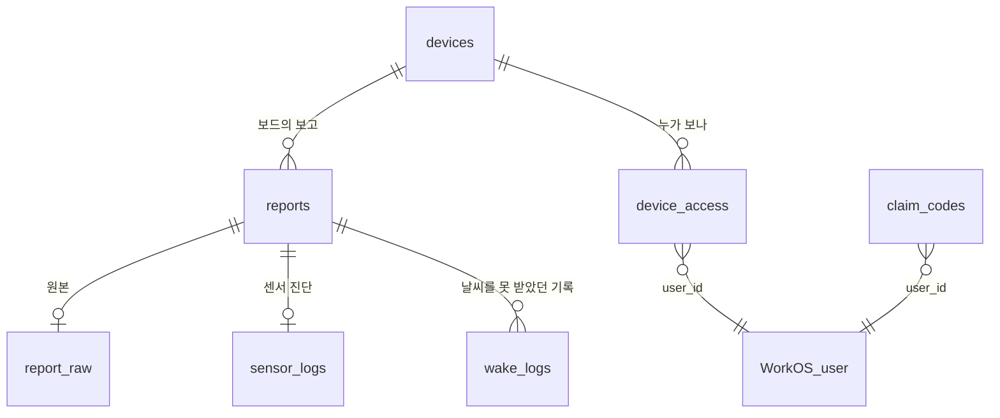
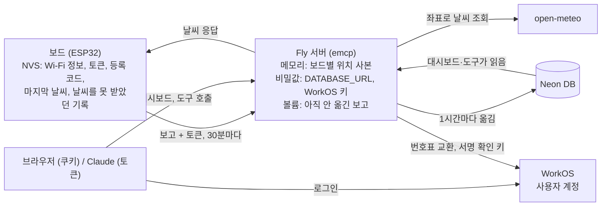

# emcp 데이터 구조

여러 사람이 쓰는 emcp에서 Neon에 만들 테이블, 테이블 사이의 관계, 그리고 DB 밖의 데이터가 어디에 있는지 정리한 문서입니다. 작업 순서는 [multi-user-rollout.ko.md](multi-user-rollout.ko.md)에 있습니다.

## 테이블 한눈에 보기

| 테이블 | 담는 것 | 보고 1건당 | 만드는 단계 |
|---|---|---|---|
| `devices` | 보드 (MAC, 이름, 날씨 위치, 토큰 해시) | 해당 없음 | 1 (위치는 3, 토큰은 4) |
| `reports` | 보고마다 하나씩 있는 값: 보드 측정값, 연결, 보드 상태, 그때 돌려준 날씨 | 1행 | 1 |
| `report_raw` | 받은 보고 원본. 나중에 칸을 추가할 때 옛 보고에서 값을 채우는 용도 | 1행 | 1 |
| `sensor_logs` | 온습도 센서 진단. 문제를 볼 때만 쓰는 값 | 1행 | 1 |
| `wake_logs` | 보드가 날씨를 못 받았던 때의 기록. 다음 보고에 몰아서 옴 | 0~여러 행 | 1 |
| `device_access` | 누가 어떤 보드를 보는지 (주인, 공유받은 사람) | 해당 없음 | 2 |
| `claim_codes` | 보드 등록 코드. 쓰면 바로 지움 | 해당 없음 | 4 |

테이블과 칸은 그걸 쓰는 단계에서 만듭니다. 이와 별도로 테이블 변경을 어디까지 적용했는지 기록하는 관리용 테이블 `schema_migrations`가 있습니다.

테이블을 나눈 기준은 이렇습니다.

| 테이블 | 기준 |
|---|---|
| `reports` | 보고마다 하나씩 있고 자주 보는 값 |
| `report_raw`, `sensor_logs` | 보고마다 하나씩이지만 거의 보지 않는 값 |
| `wake_logs` | 보고 한 건에 여러 개 실려 오는 값 |

## 관계

사용자 계정은 WorkOS에 있어서 DB에는 사용자 ID(`user_id`)만 저장합니다.

## 칸

### `reports`

보고 한 건이 한 행입니다. 칸이 많아서 묶음으로 나눠 두고, 묶음별로는 아래 뷰로 봅니다.

| 묶음 | 칸 | 뜻 |
|---|---|---|
| 기록 정보 | `id` | 보고 번호 |
| | `device_id` | 어느 보드의 보고인지 (`devices.id`) |
| | `received_at` | 서버가 보고를 받은 시각. 보드에는 시계가 없어서 서버가 찍음 |
| | `fw_version` | 그 보고를 보낸 펌웨어 버전 (git 커밋, `-dirty`는 커밋 안 된 수정이 섞인 빌드) |
| 보드 측정값 | `battery_mv` | 배터리 전압 (mV) |
| | `chip_c` | 칩 온도 (°C) |
| | `room_c`, `room_rh` | 실내 온도 (°C), 실내 습도 (%) |
| 연결 | `wifi_ms` | Wi-Fi 연결에 걸린 시간 (ms) |
| | `rssi` | Wi-Fi 신호 세기 (dBm, 0에 가까울수록 셈) |
| | `wifi_attempts` | 마지막으로 연결에 성공한 뒤 몇 번째 시도인지 (1이면 한 번에 성공) |
| 보드 상태 | `reset_reason` | 왜 깨어났는지 (8 타이머, 1 전원 들어옴, 3 재시작, 9 전압 저하) |
| | `prev_awake_ms` | **지난번에** 깨어 있던 시간 (ms). 이번 시간은 보고하는 순간 아직 끝나지 않아 잴 수 없음 |
| | `nvs_free`, `nvs_total` | 보드 저장 공간의 남은 칸과 전체 칸 |
| 날씨 | `city`, `lat`, `lon` | 그때 날씨를 조회한 도시와 좌표 |
| | `out_temp_c`, `out_humidity` | 바깥 기온 (°C), 바깥 습도 (%). 실내 값과 구분하려고 `out_`을 붙임 |
| | `out_temp_max_c`, `out_temp_min_c` | 그날 최고·최저 기온 |
| | `weather_code` | WMO 날씨 코드 (예: 3 = 흐림) |
| | `wind_kmh` | 풍속 (km/h) |
| | `pop` | 강수 확률 (%) |

- **중복 방지:** `UNIQUE (device_id, received_at)`. 같은 보고가 두 번 들어가지 않습니다.
- **날씨 칸이 비어 있으면:** 서버가 그때 날씨 조회에 실패했다는 뜻입니다. Neon으로 옮기기 전 보고에는 날씨가 저장되지 않아서 비어 있습니다.
- **`devices`의 위치와 다른 점:** `devices`의 위치는 지금 설정이고, `reports`의 위치는 그 보고 때 실제로 조회한 위치입니다. 위치를 바꿔도 지난 보고의 날씨가 어디 것이었는지 남습니다.

### `devices`

| 칸 | 뜻 | 단계 |
|---|---|---|
| `id` | 보드 번호 | 1 |
| `mac` | 보드 MAC (표시용) | 1 |
| `name` | 보드 이름 (예: 거실) | 1 |
| `created_at` | 처음 본 시각 | 1 |
| `city`, `lat`, `lon` | 날씨 위치 설정. 다음 보고 때 이 좌표로 날씨를 조회 | 3 |
| `token_hash` | 보드 토큰의 해시 | 4 |

1~3단계에는 MAC으로 보드를 찾고, MAC이 같은 보드는 한 행만 둡니다. MAC을 보내지 않는 친구 보드는 MAC이 빈 행 하나에 모입니다. 4단계부터는 토큰으로 보드를 구분합니다.

### `report_raw`, `sensor_logs`

| 테이블 | 칸 |
|---|---|
| `report_raw` | `report_id`, `body` (받은 보고 JSON. 토큰과 등록 코드는 뺌) |
| `sensor_logs` | `report_id`, `room_err`, `room_sda`, `room_scl`, `room_ack`, `room_stuck` |

`report_raw`는 Neon으로 옮긴 뒤 받은 보고부터 쌓입니다. `sensor_logs`는 센서 진단을 보내는 펌웨어의 보고에만 있습니다.

### `wake_logs`

| 칸 | 뜻 | 단계 |
|---|---|---|
| `report_id`, `idx` | 어느 보고에 실려 왔는지, 그 안에서 몇 번째인지 | 1 |
| `kind` | 무슨 일이었는지 (아래 표) | 1 |
| `wifi_attempts`, `reset_reason`, `battery_mv`, `wifi_ms`, `rssi`, `wifi_status`, `http_code` | 그때 잰 값과 실패 원인 | 1 |
| `chip_c`, `room_c`, `room_rh` | 그때 잰 온도와 습도. 펌웨어가 보내야 생김 | 4 |

### `device_access`, `claim_codes`

| 테이블 | 칸 | 단계 |
|---|---|---|
| `device_access` | `device_id`, `user_id`, `role` (`owner` 또는 `viewer`) | 2 |
| `claim_codes` | `code`, `user_id`, `expires_at` | 4 |

`device_access`는 보드 하나를 여러 사람이 공유할 수 있게 `devices`와 따로 둡니다. 공유는 행 추가, 공유 취소는 행 삭제입니다.

## 묶음별로 보는 뷰

뷰는 데이터를 따로 저장하지 않고, 자주 쓰는 조회에 이름을 붙여둔 것입니다. Neon 화면에서 테이블처럼 열어볼 수 있고, 모든 뷰에 보드 MAC과 받은 시각이 함께 나옵니다.

| 뷰 | 보이는 칸 |
|---|---|
| `report_power` | 배터리, 칩 온도, 실내 온도, 실내 습도 |
| `report_network` | Wi-Fi 연결 시간, 신호 세기, 연결 시도 횟수 |
| `report_status` | 깨어난 이유, 깨어 있던 시간, 저장 공간, 펌웨어 버전 |
| `report_weather` | 조회한 위치, 바깥 날씨, 그때의 실내 온도와 습도 |

대시보드와 서버는 뷰를 쓰지 않고 `reports`를 직접 읽습니다.

## 데이터가 있는 곳

| 어디에 | 무엇을 | 왜 거기에 |
|---|---|---|
| Neon | 보드, 보고, 로그, 공유, 등록 코드 | 오래 남겨야 하는 데이터 |
| WorkOS | 사용자 계정 | 로그인을 WorkOS가 맡으니 계정도 WorkOS가 관리 |
| Fly 비밀값 | DB 접속 주소, WorkOS 키 | 서버가 쓰는 비밀번호라서 코드나 DB에 넣지 않음 |
| Fly 볼륨 | 아직 Neon으로 안 옮긴 보고 (최대 1시간) | 1시간마다 모아서 옮기기 전까지 두는 곳. DB가 멈춰도 보고가 사라지지 않음 |
| 서버 메모리 | 보드별 위치 사본 | 보드가 보고할 때 DB를 기다리지 않고 바로 날씨를 답하려고 |
| 보드 NVS | Wi-Fi 정보, 마지막 날씨, 토큰 등 | 보드가 꺼졌다 켜져도 기억해야 하는 값 |
| 브라우저 쿠키 | 로그인 정보 | 대시보드를 열 때마다 다시 로그인하지 않게 |

보고를 바로 Neon에 쓰지 않고 1시간마다 모아서 옮기는 건 Neon 무료 한도(프로젝트당 월 100 CU-hour) 때문입니다. 보고마다 쓰면 보드 5대부터 한도를 넘고, 1시간마다 모으면 보드 수와 상관없이 월 약 15 CU-hour입니다. 누가 조회하면 남은 보고를 먼저 옮긴 뒤 읽으므로 화면에는 항상 최신 보고가 보입니다.

## Claude가 바꿀 수 있는 것

Claude는 테이블에 직접 접근하지 않고, 서버에 정해둔 도구만 호출합니다. 도구마다 정해진 칸만 바꾸고, 그 전에 이 사람이 그 보드를 볼 수 있는지부터 확인합니다.

| 테이블 | Claude가 할 수 있는 것 | 누가 | 단계 |
|---|---|---|---|
| `devices` | 날씨 위치 바꾸기, 보드 이름 바꾸기 | 주인 | 3 |
| `claim_codes` | 등록 코드 받기 | 로그인한 사람 | 4 |
| `device_access` | 공유하기, 공유 취소 | 주인 | 공유 기능 |
| `reports`, `sensor_logs`, `wake_logs` | 읽기만 | 주인, 공유받은 사람 | 6 |

`report_raw`는 서버만 쓰고 Claude 도구로는 열지 않습니다. 보고와 로그는 보드가 보낸 값만 들어가고, `mac`과 `token_hash`는 보드와 서버만 정합니다. 측정 기록을 사람이 고치면 믿을 수 없게 되고, 토큰을 바꿀 수 있으면 남의 보드를 가로챌 수 있기 때문입니다.

## 보드와 주고받는 이름

같은 데이터는 보드, 서버, DB에서 같은 이름을 씁니다. 펌웨어를 고치지 않고 맞출 수 있는 건 1단계에서 DB 쪽을 맞추고, 펌웨어를 고쳐야 하는 건 보드 등록 때문에 어차피 펌웨어를 바꾸는 4단계에 맞춥니다.

| 데이터 | 지금 보드와 주고받는 이름 | 통일한 이름 | 맞추는 쪽 | 단계 |
|---|---|---|---|---|
| 펌웨어 버전 | `fw` | `fw_version` | 펌웨어 | 4 |
| 받은 시각 | `at` | `received_at` | 서버, 대시보드 (서버가 찍는 값) | 1 |
| 센서 진단 | `room_err`, `room_sda`, … | `room_err`, `room_sda`, … | DB를 보드 이름에 맞춤 | 1 |
| 바깥 기온·습도 | `temp_c`, `humidity`, `temp_max_c`, `temp_min_c` | `out_temp_c`, `out_humidity`, `out_temp_max_c`, `out_temp_min_c` | 서버 응답과 펌웨어 | 4 |
| 날씨 설명 | `cond` | 그대로 (DB의 `weather_code`와는 다른 값) | | |
| 화면 시각 | `stamp` | 그대로 (저장하지 않음) | | |

보드를 한 번에 다 바꾸지 못할 수 있으니, 4단계 동안 서버는 `fw`와 `fw_version`을 둘 다 받고 날씨 응답에 옛 이름과 새 이름을 함께 넣습니다. 보드가 모두 바뀌면 옛 이름을 지웁니다.

## `wake_logs`에 들어가는 기록

보드는 날씨를 받지 못하면 그 사실을 저장해 두고 5분 뒤 다시 시도합니다. 저장한 기록은 다음 보고에 함께 실려 옵니다. 2026-11-02까지 쌓인 실제 기록 338건을 종류별로 나눴습니다.

| `kind` | 무슨 일 | 보고가 서버에 도착했나 | 건수 | 저장 |
|---|---|---|---|---|
| `wifi` | Wi-Fi 연결 실패 | 아니요 | 146 | 함 |
| `portal-lost`, `portal-timeout` | Wi-Fi를 못 찾아 설정 페이지로 넘어감 | 아니요 | 73 | 함 |
| `http` -1, -5 | 서버 연결 실패 | 아니요 | 22 | 함 |
| `http` -11 | 서버 응답이 늦음 | 도착 | 8 | 함 |
| `http` 500 | 서버가 날씨 조회에 실패 | 도착, 저장됨 | 88 | 안 함 |
| `full` | 보드의 기록 공간이 꽉 참 | 해당 없음 | 1 | 함 |

- **500은 저장하지 않습니다.** 그 보고는 이미 `reports`에 있고 날씨 칸만 비어 있으므로, 날씨 조회 실패는 거기서 알 수 있습니다.
- **반복된 기록은 거릅니다.** 보드는 200 응답을 받아야 기록을 지우기 때문에, 500이 이어지면 앞 보고에 실었던 기록을 다음 보고에 또 싣습니다. 같은 보드의 바로 앞 보고에 이미 실렸던 기록은 다시 넣지 않아서, 실패 한 번이 한 행으로만 들어갑니다.
- **4단계에서 측정값을 더합니다.** 지금 실패 기록에는 배터리만 있고 온도가 없어서, 추위 때문에 낮아진 배터리 값을 가려낼 수 없습니다. 보드가 Wi-Fi를 켜기 전에 이미 잰 `chip_c`, `room_c`, `room_rh`를 실패 기록에도 넣고, 기록 공간을 1KB에서 2KB로 늘립니다.

## 나중에 고치기 쉽게

- **테이블 변경은 번호 붙은 목록으로 관리합니다.** `db.py`의 `MIGRATIONS`에 순서대로 붙이기만 하고, 서버가 켜질 때 아직 적용하지 않은 번호만 실행합니다. 앱 두 개가 같은 DB를 쓰므로 동시에 켜져도 한쪽만 적용하도록 DB 잠금을 겁니다.
- **보고 항목 정의는 한 곳에 둡니다.** 검증, 저장, 읽기가 `db.py`의 같은 목록을 봅니다. 새 항목을 추가할 때는 이 목록 한 줄과 `MIGRATIONS` 한 줄만 고칩니다.
- **SQL은 `db.py`에만 씁니다.** "그 사람이 볼 수 있는 보드만" 거르는 조건도 여기 한 곳에 둡니다.
- **DB를 바꾸기 전에 Neon 브랜치에서 먼저 시험합니다.** 운영 DB를 복사한 브랜치에 변경을 적용해 실제 데이터로 확인한 뒤 운영에 올립니다.
