# emcp 데이터 구조

emcp가 Neon에 두는 테이블과 그 관계, DB 밖에 있는 데이터를 적었습니다. 로그인, 보드 등록, 공유가 어떻게 동작하는지는 [multi-user-rollout.ko.md](multi-user-rollout.ko.md)에 있습니다.

## 테이블 한눈에 보기

| 테이블 | 담는 것 | 보고 1건당 | 만든 단계 |
|---|---|---|---|
| `devices` | 보드 (MAC, 이름, 날씨 위치, 토큰 해시, 주인 이메일) | 해당 없음 | 1 (위치는 3, 토큰과 주인 이메일은 4) |
| `reports` | 보고마다 하나씩 있는 값: 보드 측정값, 연결, 보드 상태, 그때 돌려준 날씨 | 1행 | 1 (시간대는 4) |
| `report_raw` | 받은 보고 원본. 나중에 칸을 추가하면 옛 보고의 값을 여기서 채움 | 0~1행 | 1 |
| `sensor_logs` | 온습도 센서 진단. 문제를 볼 때만 쓰는 값 | 0~1행 | 1 |
| `wake_logs` | 보드가 날씨를 못 받았던 때의 기록. 다음 보고에 몰아서 옴 | 0~여러 행 | 1 (온습도는 4) |
| `device_access` | 누가 어떤 보드를 보는지 (주인, 공유받은 사람) | 해당 없음 | 2 (수락 여부와 이메일은 공유 때) |
| `claim_codes` | 등록 코드. 사람과 보드가 각자 채우고, 연결되면 바로 지움 | 해당 없음 | 4 |
| `app_state` | 서버가 기억해 둘 값. 지금은 WorkOS 계정 삭제를 어디까지 확인했는지 하나 | 해당 없음 | 4 |

이 밖에 테이블 변경을 어디까지 적용했는지 적어 두는 관리용 테이블 `schema_migrations`가 있습니다. 사용자, 세션, OAuth 테이블은 없습니다. 계정과 로그인은 WorkOS에 있습니다.

테이블을 나눈 기준은 이렇습니다.

| 테이블 | 기준 |
|---|---|
| `reports` | 보고마다 하나씩 있고 자주 보는 값 |
| `report_raw`, `sensor_logs` | 보고마다 많아야 하나이고 거의 보지 않는 값 |
| `wake_logs` | 보고 한 건에 여러 개 실려 오는 값 |

## 관계

- `devices`가 가운데에 있습니다. `reports`와 `device_access`가 보드 번호(`device_id`)로 `devices`를 가리킵니다.
- `report_raw`, `sensor_logs`, `wake_logs`는 보고 번호(`report_id`)로 `reports`를 가리킵니다.
- 사용자 계정은 WorkOS에 있어서 DB에는 사용자 ID(`user_id`)만 저장합니다. `device_access.user_id`와 `claim_codes.user_id`는 외래 키가 걸리지 않은 WorkOS 사용자 ID입니다.
- `claim_codes`는 `devices`와 외래 키로 이어지지 않습니다. 사람 몫(`user_id`, `email`)과 보드 몫(`token_hash`, `mac`)이 다 차면 서버가 `devices`와 `device_access`에 행을 만들거나 고치고, 이 줄을 지웁니다.
- `app_state`는 다른 테이블과 이어지지 않습니다.

`device_access`, `report_raw`, `sensor_logs`, `wake_logs`는 가리키는 행이 지워지면 같이 지워집니다(`ON DELETE CASCADE`). `reports`에는 이 설정이 없어서 보고가 남아 있는 보드 행은 지울 수 없습니다. 보드 행을 지우는 곳(예전 기록 가져오기)은 보고를 먼저 옮기거나 지웁니다.

## 칸

### `reports`

보고 한 건이 한 행입니다. 칸이 많아서 묶음으로 나눴고, 묶음별로는 아래 뷰로 봅니다.

| 묶음 | 칸 | 뜻 |
|---|---|---|
| 기록 정보 | `id` | 보고 번호 |
| | `device_id` | 어느 보드의 보고인지 (`devices.id`) |
| | `received_at` | 서버가 보고를 받은 시각 (UTC). 보드에는 시계가 없어서 서버가 찍음 |
| | `fw_version` | 그 보고를 보낸 펌웨어 버전 (git 커밋. `-dirty`는 커밋 안 된 수정이 섞인 빌드) |
| 보드 측정값 | `battery_mv` | 배터리 전압 (mV) |
| | `chip_c` | 칩 온도 (°C) |
| | `room_c`, `room_rh` | 실내 온도 (°C), 실내 습도 (%) |
| 연결 | `wifi_ms` | Wi-Fi 연결에 걸린 시간 (ms) |
| | `rssi` | Wi-Fi 신호 세기 (dBm, 0에 가까울수록 셈) |
| | `wifi_attempts` | 마지막으로 연결에 성공한 뒤 몇 번째 시도인지 (1이면 한 번에 성공) |
| 보드 상태 | `reset_reason` | 왜 깨어났는지 (8 타이머, 1 전원 들어옴, 3 재시작, 9 전압 저하) |
| | `prev_awake_ms` | 지난번에 깨어 있던 시간 (ms). 이번 시간은 보고하는 순간에 아직 끝나지 않아서 잴 수 없음 |
| | `nvs_free`, `nvs_total` | 보드 저장 공간의 남은 칸과 전체 칸 |
| 날씨 | `city`, `lat`, `lon` | 그때 날씨를 조회한 도시와 좌표 |
| | `timezone` | 그 도시의 시간대 (예: `Europe/Berlin`) |
| | `out_temp_c`, `out_humidity` | 바깥 기온 (°C), 바깥 습도 (%). 실내 값과 헷갈리지 않게 `out_`을 붙임 |
| | `out_temp_max_c`, `out_temp_min_c` | 그날 최고·최저 기온 |
| | `weather_code` | WMO 날씨 코드 (예: 3 = 흐림) |
| | `wind_kmh` | 풍속 (km/h) |
| | `pop` | 강수 확률 (%) |

`UNIQUE (device_id, received_at)`가 걸려 있어서 같은 보고는 두 번 들어가지 않습니다.

대시보드는 `received_at`을 `timezone`의 현지 시각으로 바꿔 보여 줍니다. 시간대가 없는 옛 보고는 그 보드의 가장 최근 시간대를 쓰고, 그것도 없으면 기본 위치인 뮌헨의 시간대를 씁니다.

날씨 칸이 비어 있으면 그때 서버가 날씨 조회에 실패했다는 뜻입니다. Neon으로 옮기기 전 보고는 날씨를 저장하지 않아서 비어 있습니다.

`devices`에도 위치가 있지만 뜻이 다릅니다. `devices`의 위치는 지금 설정이고, `reports`의 위치는 그 보고 때 실제로 조회한 위치입니다. 그래서 위치를 바꿔도 지난 보고의 날씨가 어디 것이었는지 남습니다.

### `devices`

| 칸 | 뜻 | 단계 |
|---|---|---|
| `id` | 보드 번호 | 1 |
| `mac` | 보드 MAC (표시용) | 1 |
| `name` | 보드 이름 (예: 거실) | 1 |
| `created_at` | 행을 만든 시각 | 1 |
| `city`, `lat`, `lon` | 날씨 위치 설정. 다음 보고 때 이 좌표로 날씨를 조회. 비어 있으면 뮌헨 | 3 |
| `token_hash` | 보드 토큰의 SHA-256 해시. 비어 있으면 아직 토큰이 없거나 등록을 해제한 보드 | 4 |
| `owner_email` | 등록한 사람의 이메일. 같은 보드를 다시 등록한 사람과 같으면 예전 기록을 가져올지 물음 | 4 |
| `history_declined` | 예전 기록을 "그냥 두기"로 한 보드. 다시 묻지 않음 | 4 |

보드는 토큰으로 구분하고 MAC은 표시용이라, MAC이 같은 행이 여럿 있을 수 있습니다. 등록된 적 있는 보드를 다른 계정이 등록하면 같은 MAC의 새 행으로 시작합니다. 같은 계정이 다시 등록하면 기존 행을 이어 씁니다.

MAC을 보내지 않던 옛 펌웨어의 보고는 MAC이 빈 행 하나에 모여 있습니다. 토큰 없이 오는 옛 보고(`emcp-led`)는 같은 MAC의 가장 오래된 행으로 갑니다.

### `report_raw`, `sensor_logs`

| 테이블 | 칸 |
|---|---|
| `report_raw` | `report_id`, `body` (받은 보고 JSON. 토큰과 등록 코드는 뺌) |
| `sensor_logs` | `report_id`, `room_err`, `room_sda`, `room_scl`, `room_ack`, `room_stuck` |

`report_raw`는 Neon으로 옮긴 뒤에 받은 보고부터 쌓입니다. `sensor_logs`는 센서 진단을 보내는 펌웨어의 보고에만 있습니다.

### `wake_logs`

| 칸 | 뜻 | 단계 |
|---|---|---|
| `report_id`, `idx` | 어느 보고에 실려 왔는지, 그 안에서 몇 번째인지 | 1 |
| `kind` | 무슨 일이었는지 (아래 표) | 1 |
| `wifi_attempts`, `reset_reason`, `battery_mv`, `wifi_ms`, `rssi`, `wifi_status`, `http_code` | 그때 잰 값과 실패 원인 | 1 |
| `chip_c`, `room_c`, `room_rh` | 그때 잰 온도와 습도. 4단계 펌웨어부터 실려 옴 | 4 |

### `device_access`, `claim_codes`, `app_state`

| 테이블 | 칸 | 단계 |
|---|---|---|
| `device_access` | `device_id`, `user_id` (WorkOS 사용자 ID), `role` (`owner` 또는 `viewer`) | 2 |
| `device_access` | `accepted` (공유받은 사람이 수락했는지. 주인 줄은 늘 참), `email` (누구인지 화면에 보여 줄 이메일) | 공유 |
| `claim_codes` | `code`, `user_id`와 `email` (코드를 넣은 사람), `token_hash`와 `mac` (코드를 물어본 보드), `expires_at` | 4 |
| `app_state` | `key`, `value` | 4 |

`device_access`의 기본 키는 `(device_id, user_id)`라서 한 사람은 한 보드에 한 줄만 가집니다. 보드 하나를 여러 사람이 볼 수 있도록 `devices`와 따로 둡니다.

공유하면 수락 전 줄(`accepted = false`)을 하나 넣고, 받는 사람이 수락하면 참으로 바꿉니다. 거절, 공유 취소, 목록에서 빼기는 그 줄을 지웁니다. 보고를 읽는 조회는 수락한 줄만 봅니다.

`email`은 주인 줄에는 등록할 때, 공유받은 사람 줄에는 공유할 때 적습니다. 사람은 `user_id`로 구분하지만, 주인이 공유를 취소할 때는 이 이메일로 줄을 찾습니다.

`claim_codes`의 줄은 사람이나 보드 중 먼저 온 쪽이 만들고, `expires_at`을 1시간 뒤로 정합니다. 연결되거나 만료되면 지웁니다.

`app_state`에는 지금 `deleted_users_since` 하나만 있습니다. WorkOS에 지워진 계정을 어디까지 물어봤는지 적어 두는 값입니다.

## 묶음별로 보는 뷰

뷰는 자주 쓰는 조회에 이름을 붙여 둔 것이라 데이터를 따로 저장하지 않습니다. Neon 화면에서 테이블처럼 열 수 있고, 어느 뷰에나 보드 MAC과 받은 시각이 같이 나옵니다.

| 뷰 | 보이는 칸 |
|---|---|
| `report_power` | 배터리, 칩 온도, 실내 온도, 실내 습도 |
| `report_network` | Wi-Fi 연결 시간, 신호 세기, 연결 시도 횟수 |
| `report_status` | 깨어난 이유, 깨어 있던 시간, 저장 공간, 펌웨어 버전 |
| `report_weather` | 조회한 위치, 바깥 날씨, 그때의 실내 온도와 습도 |

대시보드와 서버는 뷰를 쓰지 않고 `reports`를 바로 읽습니다.

## 데이터가 있는 곳

| 어디에 | 무엇을 | 왜 거기에 |
|---|---|---|
| Neon | 보드, 보고, 로그, 공유, 등록 코드, 서버 상태 | 오래 남겨야 하는 데이터 |
| WorkOS | 사용자 계정과 이메일 | 로그인을 WorkOS가 맡으니 계정도 WorkOS가 관리 |
| Fly 비밀값 | DB 접속 주소, WorkOS API 키, 쿠키 암호화 키 | 서버가 쓰는 비밀번호라서 코드나 DB에 넣지 않음 |
| Fly 볼륨 | 아직 Neon으로 안 옮긴 보고 (보통 1시간 안쪽) | 1시간마다 모아서 옮기기 전까지 두는 곳. DB가 멈춰도 보고가 사라지지 않음 |
| 서버 메모리 | 보드 사본 (토큰 해시, MAC, 날씨 위치) | 보고가 올 때 DB를 깨우지 않고 바로 날씨를 답하려고 |
| 보드 NVS | Wi-Fi 정보, 토큰, 등록 코드, 마지막 날씨, 못 보낸 보고 기록 | 보드가 꺼졌다 켜져도 기억해야 하는 값 |
| 브라우저 쿠키 | 암호화한 로그인 정보 (사용자 ID, 12시간) | 대시보드를 열 때마다 다시 로그인하지 않게 |

보고를 1시간마다 모아서 Neon에 옮기는 건 Neon 무료 한도(프로젝트당 월 100 CU-hour) 때문입니다. 보고가 올 때마다 쓰면 보드 5대부터 한도를 넘지만, 1시간마다 모으면 보드 수와 상관없이 월 약 15 CU-hour입니다. 누가 대시보드를 열면 남은 보고를 먼저 옮긴 뒤 읽기 때문에 화면에는 늘 최신 보고가 나옵니다.

서버의 보드 사본은 서버가 뜰 때, 보고를 Neon으로 옮길 때, 위치를 바꾸거나 보드를 등록하고 해제할 때 다시 읽습니다. 앱(`emcp`, `emcp-led`)마다 사본이 따로라서, 다른 앱에서 바꾼 위치는 이 앱이 다음에 보고를 옮길 때 들어옵니다.

## 누가 무엇을 바꿀 수 있나

Claude는 테이블을 직접 건드리지 못하고 서버에 정해 둔 도구만 부릅니다. 대시보드도 정해 둔 버튼으로만 바꿉니다. 보드를 바꾸는 요청은 요청한 사람이 그 보드의 주인인지부터 확인합니다.

| 테이블 | 할 수 있는 것 | 누가 | 어디서 |
|---|---|---|---|
| `devices` | 이름 바꾸기, 날씨 위치 바꾸기 | 주인 | 대시보드, Claude |
| `devices` | 등록 해제, 예전 기록 가져오기나 그냥 두기 | 주인 | 대시보드 |
| `claim_codes` | 등록 코드 입력 | 로그인한 사람 | 대시보드, Claude |
| `device_access` | 공유 요청, 공유 취소 | 주인 | 대시보드 |
| `device_access` | 수락, 거절, 목록에서 빼기 | 공유받은 사람 | 대시보드 |
| `reports`, `sensor_logs`, `wake_logs` | 읽기만 | 주인, 수락한 사람 | 대시보드. Claude 도구는 6단계 |

`report_raw`는 서버만 씁니다. 보고와 로그에는 보드가 보낸 값만 들어가고, `mac`과 `token_hash`는 보드와 서버만 정합니다. 사람이 측정 기록을 고칠 수 있으면 기록을 믿을 수 없고, 토큰을 바꿀 수 있으면 남의 보드를 가로챌 수 있어서입니다.

## 보드와 주고받는 이름

같은 데이터는 보드, 서버, DB에서 같은 이름으로 부릅니다. 4단계 펌웨어는 새 이름을 쓰고, 옛 펌웨어는 옛 이름을 씁니다.

| 데이터 | 옛 이름 | 지금 이름 | 비고 |
|---|---|---|---|
| 펌웨어 버전 (보고) | `fw` | `fw_version` | |
| 바깥 기온·습도 (서버 응답) | `temp_c`, `humidity`, `temp_max_c`, `temp_min_c` | `out_temp_c`, `out_humidity`, `out_temp_max_c`, `out_temp_min_c` | |
| 받은 시각 | `at` | `received_at` | 서버가 찍는 값이라 보드와는 상관없음 |
| 센서 진단 | `room_err`, `room_sda`, … | 그대로 | DB를 보드 이름에 맞춤 |
| 날씨 설명 | `cond` | 그대로 | DB의 `weather_code`와는 다른 값. 저장하지 않음 |
| 화면 시각 | `stamp` | 그대로 | 저장하지 않음 |

옛 펌웨어 보드가 남아 있는 동안 서버는 `fw`와 `fw_version`을 둘 다 받고, 날씨 응답에도 옛 이름과 새 이름을 함께 넣습니다. 옛 펌웨어 보드가 없어지면 옛 이름을 지웁니다.

## `wake_logs`에 들어가는 기록

보드는 날씨를 받지 못하면 그 일을 기록해 두고 5분 뒤 다시 시도합니다. 기록은 다음 보고에 실려 옵니다.

| `kind` | 무슨 일 | 보고가 서버에 도착했나 | 저장 |
|---|---|---|---|
| `wifi` | Wi-Fi 연결 실패 | 아니요 | 함 |
| `portal-new`, `portal-lost`, `portal-timeout` | 설정 페이지가 열림 (처음 설정, Wi-Fi를 못 찾음), 설정 시간 초과 | 아니요 | 함 |
| `http` -1, -5 | 서버 연결 실패 | 아니요 | 함 |
| `http` -11 | 서버 응답이 늦음 | 도착 | 함 |
| `http` 429, 503 | 서버가 보드를 확인하지 못함 | 도착했지만 저장 안 됨 | 함 |
| `http` 500 | 서버가 날씨 조회에 실패 | 도착, 저장됨 | 안 함 |
| `full` | 보드의 기록 공간이 꽉 참 | 해당 없음 | 함 |

500은 저장하지 않습니다. 그 보고는 이미 `reports`에 있고 날씨 칸만 비어 있으므로, 날씨 조회 실패는 거기서 알 수 있습니다.

같은 기록이 되풀이되면 거릅니다. 보드는 200 응답을 받아야 기록을 지우기 때문에, 500이 이어지면 앞 보고에 실었던 기록을 다음 보고에 또 싣습니다. 서버는 같은 보드의 바로 앞 보고에 이미 실렸던 기록을 다시 넣지 않으므로, 실패 한 번은 한 행으로만 들어갑니다.

4단계 펌웨어부터는 실패 기록에도 `chip_c`, `room_c`, `room_rh`가 실립니다. 온도가 있어야 추위 때문에 낮아진 배터리 값을 가려낼 수 있습니다. 보드는 Wi-Fi를 켜기 전에 잰 값을 그대로 싣고, 기록 공간은 2KB입니다.

## 나중에 고치기 쉽게

- 테이블 변경은 `db.py`의 `MIGRATIONS` 끝에 붙이기만 합니다. 서버가 처음 DB에 붙을 때 아직 적용하지 않은 번호만 실행하고, 앱 두 개가 같은 DB를 쓰므로 동시에 켜져도 한쪽만 적용하도록 DB 잠금을 겁니다.
- 보고 항목 정의는 한 곳에 둡니다. 검증, 저장, 읽기가 모두 `db.py`의 같은 목록을 보기 때문에, 새 항목을 추가할 때는 이 목록 한 줄과 `MIGRATIONS` 한 줄만 고치면 됩니다.
- SQL은 `db.py`에만 씁니다. "그 사람이 볼 수 있는 보드만" 거르는 조건도 여기 한 곳(`devices_for`)에 있습니다.
- DB를 바꾸기 전에 Neon 브랜치에서 먼저 시험합니다. 운영 DB를 복사한 브랜치에 변경을 적용해 실제 데이터로 확인한 뒤 운영에 올립니다.
