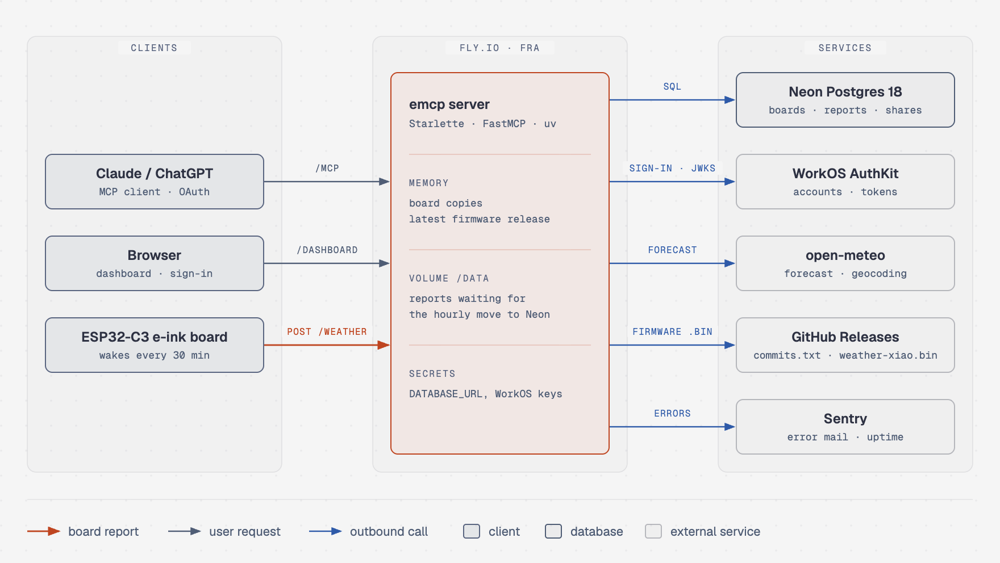
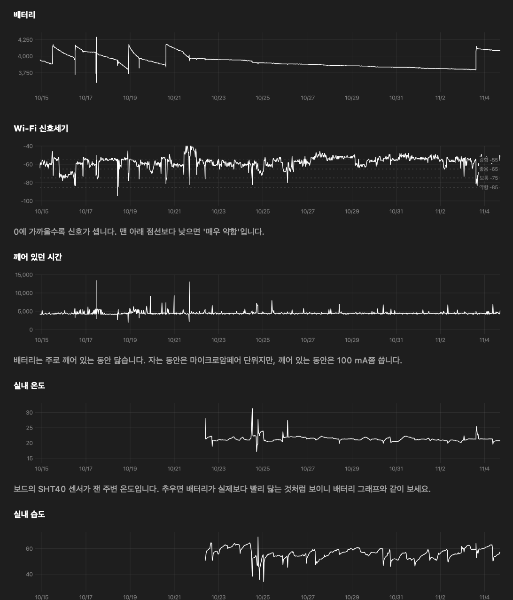
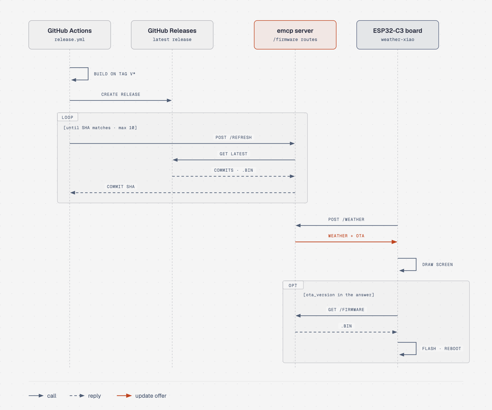

[English](../../README.md) | [한국어](README.md)

# emcp

ESP32 e-ink 날씨 보드용 서버.

- 보드: 깨어날 때마다 상태 보고, 같은 응답으로 그 보드 위치의 날씨 수신
- 사용자: Claude, ChatGPT에서 MCP 도구로 보드 이름과 날씨 위치 변경, 웹 대시보드에서 보고 확인
- 펌웨어: 별도 저장소 [eink-weather-display](https://github.com/seung-gu/eink-weather-display)

[](https://github.com/seung-gu/emcp/actions/workflows/deploy.yml)




- 로그인: WorkOS AuthKit 담당, 사람마다 자기 보드만 조회 가능
- 보드 등록 설계: [multi-user-rollout.ko.md](../multi-user-rollout.ko.md)

## 대시보드



로그인 후 `/dashboard`:

- 보드 관리: 이름 변경, 날씨 위치 변경, 이메일로 공유, 등록 해제, 코드로 보드 추가
- 그래프: 배터리, Wi-Fi 신호세기, 깨어 있던 시간, 실내 온도와 습도, 칩 온도, NVS 사용량. 6시간~7일, 전체 범위 선택, 끌어서 확대, 시각은 보드 위치의 현지 시각
- 표: 최근 보고 50건, 당시 보내지 못한 보고

## 스택

| 영역 | 사용 | 용도 |
|---|---|---|
| 언어, 패키지 | Python 3.12, uv | 서버 전체, `uv.lock` |
| MCP | 공식 `mcp` SDK의 FastMCP (Streamable HTTP, stateless) | Claude, ChatGPT용 도구 |
| 웹 | Starlette, uvicorn, Jinja2 | 보드 API, 대시보드, 로그인 |
| DB | Neon Postgres 18, psycopg 3 | 보드, 보고, 공유 정보 |
| 로그인 | WorkOS AuthKit (Staging), PyJWT | 대시보드 로그인, MCP 토큰 확인 |
| 외부 HTTP 호출 | httpx | open-meteo, GitHub Releases |
| 날씨 | open-meteo (예보, 지명 검색, API 키 불필요) | `/weather` 응답, 위치 검색 |
| 호스팅 | Fly.io `fra`, shared-cpu-1x, 256MB, 1대 상시 가동 | 운영 서버 |
| 머신 디스크 | Fly 볼륨 `/data` | Neon으로 옮기기 전 보고 버퍼 |
| CI/CD | GitHub Actions | `main` push마다 테스트 후 배포 |
| 모니터링 | Sentry (EU), 5분 간격 Uptime 확인 | 에러, 서버 다운 메일 |
| 테스트 | pytest, Docker Postgres 18 | 운영 서비스 접근 없음 |

## MCP 도구

- 엔드포인트 `https://<host>/mcp`, Streamable HTTP, 로그인 필요
- 모든 도구는 부른 사람의 보드만 대상

| 도구 | 동작 |
|---|---|
| `register_device(code)` | 보드 화면의 6자리 등록 코드로 보드를 내 계정에 등록 |
| `get_weather_location` | 내 보드 목록: 번호, 이름, MAC, 날씨 위치, 역할 (`"3 / 거실 / E8F60A17AF28 / 뮌헨 (기본값) / 주인"`) |
| `search_location(query, count=5)` | 지명으로 좌표 후보 검색 (open-meteo geocoding) |
| `set_weather_location(device_id, name, latitude, longitude)` | 보드 하나의 날씨 위치 설정. 주인만 가능 |
| `rename_device(device_id, name)` | 보드 이름 변경. 주인만 가능 |
| `get_reports(device_id, hours=24)` | 내 보드나 수락한 공유 보드의 최근 보고: 배터리, Wi-Fi, 실내 온습도, 평소와 다른 깨어남. 1~168시간 |

위치 미설정 보드는 뮌헨 날씨 표시. 위치 변경 순서는 `get_weather_location` → `search_location` → 후보 선택 → `set_weather_location`:

```
사용자: "거실 보드 베를린 날씨로 바꿔줘"
  → get_weather_location()
      3 / 거실 / E8F60A17AF28 / 뮌헨 (기본값) / 주인
  → search_location("Berlin")
      베를린 / 베를린 / 독일 / 52.52437,13.41053 / 인구 3426354
      벌린 / 뉴햄프셔주 / 미국 / 44.46867,-71.18508 / 인구 9367   ← 동명이지 주의
  → set_weather_location(3, "베를린", 52.52437, 13.41053)
```

검색 단계를 도구로 둔 이유:

- LLM이 기억으로 넣은 좌표는 틀려도 에러 없음. 결과는 엉뚱한 도시의 날씨
- 한글보다 로마자 질의가 정확. `"광주"`는 충남 천안의 작은 지명 하나만, `"Gwangju"`는 광주광역시가 맨 위

## HTTP 경로

| 메서드와 경로 | 응답 | 사용처 |
|---|---|---|
| `POST /weather` | 날씨 JSON | 보드, 깨어날 때마다. 등록 전에는 등록 여부 확인만 |
| `GET /firmware/<보드 종류>/<버전>` | 펌웨어 파일 | 업데이트 중인 보드. IP당 시간당 6번 |
| `POST /firmware/refresh` | `{"commit": "<SHA>"}` | 펌웨어 릴리스 워크플로. 전체 시간당 20번 |
| `GET /r/<코드>` | 대시보드로 이동 | 보드 화면의 QR. 코드가 채워진 대시보드로 연결 |
| `GET /dashboard` | 대시보드 | 로그인한 사용자 |
| `GET /health` | `ok` | Fly.io 헬스체크 |

### 등록

- 등록 전 보드: 측정값 없이 토큰과 등록 코드만 전송
- 전체 순서: [multi-user-rollout.ko.md](../multi-user-rollout.ko.md)

```json
{"mac": "E8F60A17AF28", "token": "<소문자 16진수 64자>", "claim_code": "4J7K2P"}
```

| 응답 | 뜻 |
|---|---|
| 200, 날씨와 `"registered": true` | 등록 완료. 이후 평소처럼 보고 |
| 200, `{"registered": false}` | 아직 아무도 코드를 입력하지 않음 |
| 409, `"new_code": true` | 다른 보드가 같은 코드 사용 중. 보드가 코드를 새로 생성 |

### 보고와 날씨

- 등록된 보드의 본문: 그 wake의 상태 보고. 날씨 요청에 얹어 보내므로 왕복 추가 없음
- 서버: 토큰으로 보드를 찾아 그 보드 위치의 날씨로 응답

```json
{"mac": "E8F60A17AF28", "token": "<토큰>", "battery_mv": 3912, "wifi_ms": 184, "rssi": -58}
```

- 모르는 토큰(등록 해제된 보드): 401 `{"registered": false}`. 보드는 이때만 토큰 삭제 후 새 코드 표시
- 429(횟수 제한), 503(DB 장애): 서버가 보드를 확인하지 못한 경우라 토큰 유지
- 수치는 숫자로만 전송. `°C`, `km/h`는 기기 쪽에서 표시
- 바깥 날씨는 옛 펌웨어용 이름(`temp_c` 등)과 새 펌웨어용 이름(`out_temp_c` 등)으로 함께 전송

```json
{"city": "뮌헨", "temp_c": 19, "cond": "구름 조금", "wind_kmh": 4,
 "humidity": 61, "temp_max_c": 24, "temp_min_c": 17, "pop": 25,
 "stamp": "Fri 14:30", "out_temp_c": 19, "out_humidity": 61,
 "out_temp_max_c": 24, "out_temp_min_c": 17}
```

- 날씨 조회 실패: 날씨 키 없이 `{"city": "뮌헨"}`만 담아 HTTP 500
- 펌웨어가 상태 코드로 본문을 거르므로 이 응답은 화면에 표시되지 않음

## 펌웨어 업데이트



1. 펌웨어 저장소에 `v*` 태그 push → `commits.txt`, `weather-xiao.bin`을 담은 GitHub 릴리스 생성
2. 릴리스 워크플로가 `POST /firmware/refresh` 호출 → 서버가 최신 릴리스를 메모리에 받아 두고(`emcp/infra/firmware.py`) 그 커밋으로 응답. 워크플로는 커밋이 태그와 같아질 때까지 최대 10번 재시도
3. 보고의 `fw_commit`이 그 릴리스의 옛 커밋이고 배터리 3.7V 이상인 보드: 날씨와 함께 `"ota_version": "<SHA 40자>"` 수신
4. 보드는 화면을 먼저 그린 뒤 `GET /firmware/<fw_board>/<sha>`로 받아 설치 후 재시작. 새 펌웨어는 서버에 닿은 wake가 나올 때까지 시험 상태, 그 전에 리셋되면 부트로더가 이전 펌웨어로 복귀

규칙:

- GitHub 조회 시점: 서버 시작 때(릴리스를 메모리에만 두므로, 최대 10번)와 워크플로 호출 때뿐
- 최신 릴리스만, `weather-xiao`용만 제공
- 릴리스에 없는 커밋, 손으로 올린 `-dirty` 빌드에는 업데이트 제안 없음
- 릴리스 빌드는 `fw_version`에 태그 이름(`v1.02`) 전송, 대시보드에 그대로 표시. `fw_commit`이 없는 옛 펌웨어는 `fw_version`이 커밋

## 코드 구조

- 폴더 하나가 층 하나
- 위 층만 아래 층 호출, 입구 모듈끼리 import 금지
- 층별 구성은 각 폴더의 `__init__.py`에 기록

```
emcp/
  server.py   조립: 경로와 도구를 앱 하나로 묶어 실행 (python -m emcp.server)
  entry/      1층 입구: board_api.py (보드), web.py (로그인, 대시보드),
              tools.py (MCP), dashboard/ (화면)
  service/    2층, 입구 여럿이 같이 쓰는 동작: actions.py, checks.py
  state/      3층 서버 메모리: devices.py (보드 사본), buffer.py (보고 버퍼)
  infra/      4층 바깥 시스템: db/ (Neon, SQL은 여기에만), auth.py (WorkOS),
              weather.py (open-meteo), firmware.py (GitHub Releases)
tests/        pytest (Docker Postgres)
```

## 로컬 실행

- 작업 디렉터리의 `.env`에 접속 정보 기록 (gitignore 대상)
- `MCP_AUTH_ISSUER` 없으면 서버 시작 불가

```text
DATABASE_URL=postgresql://...
WORKOS_CLIENT_ID=client_...
WORKOS_API_KEY=sk_...
MCP_AUTH_ISSUER=https://<authkit 도메인>
WORKOS_COOKIE_PASSWORD=<Fernet 키>
```

```bash
uv sync
uv run --env-file .env python -m emcp.server   # 기본 포트 8080, PORT 환경변수로 변경
curl http://127.0.0.1:8080/health                                            # ok
curl -s -o /dev/null -w '%{http_code}\n' -X POST http://127.0.0.1:8080/mcp   # 401 (로그인 필요)
```

- 로컬도 운영과 같은 Neon 사용
- 로컬 `POST /weather`로 보낸 보고는 한 시간 안에 Neon으로 옮겨져 실제 기록에 섞임

## 테스트

- Docker로 띄운 로컬 Postgres 18 사용 (운영 Neon과 같은 메이저 버전)
- 운영 DB, WorkOS, open-meteo 접근 없음, 테스트마다 테이블 비움

```bash
sh scripts/test-db.sh   # 처음 한 번, 또는 Docker 재시작 뒤
uv run pytest
```

- `TEST_DATABASE_URL`로 다른 로컬 DB 지정 가능
- 로컬이 아닌 주소면 테스트 시작 거부

## 배포

- `main` push → 테스트(`.github/workflows/test.yml`) → 통과 시 Fly.io 배포(`deploy.yml`)
- Actions 탭의 deploy에서 "Run workflow"로 재배포 가능
- 저장소 비밀값 `FLY_API_TOKEN`: `fly tokens create deploy -a emcp`로 생성

처음 한 번 설정 (앱마다). 볼륨 이름은 `fly.toml`의 `[mounts] source`와 일치 필요:

```bash
fly volumes create reports --size 1 --region fra
fly secrets import < .env                           # 값이 화면에 찍히지 않음
fly secrets set PUBLIC_URL=https://<app>.fly.dev    # 토큰의 aud와 로그인 주소에 사용
fly deploy --ha=false
```

- Sentry: `fly secrets set SENTRY_DSN=...`로 켜짐, 없으면 전송 없음. 요청 본문(보드 토큰 포함)과 개인정보는 전송 안 함
- 옛 앱 `emcp-led`: 옛 펌웨어 보드가 아직 토큰 없이 `emcp-led.fly.dev`로 보고. 같은 코드를 `ACCEPT_TOKENLESS=1`과 함께 손으로 배포(`fly deploy --ha=false -a emcp-led`). 이 값이 빠지면 옛 보드의 보고가 전부 거절되고, 보드가 5분마다 재시도하며 배터리 소모. `emcp`에는 설정 금지

## 보고 보관

- 보고는 먼저 `REPORTS_BUFFER` 파일에 한 줄씩 적재, 앱 안 타이머가 한 시간에 한 번 Neon으로 이동. 옮길 보고가 없으면 DB를 깨우지 않음. 이유는 Neon 무료 한도
- 대시보드를 열면 남은 보고를 먼저 옮긴 뒤 Neon에서 조회
- 테이블 구조: [data-structure.ko.md](../data-structure.ko.md). 로컬 실행은 `pending-reports.jsonl` 사용 (gitignore 대상)
- 날씨 위치는 Neon `devices`에 저장. 보고에 DB를 기다리지 않고 답하려고 서버가 MAC별 사본을 메모리에 보관. 사본은 서버 시작, 매시간 이동, 위치 변경 때 다시 읽음. `emcp`와 `emcp-led`가 같은 DB를 쓰는 동안 한쪽의 변경은 다른 쪽의 다음 이동 때(최대 한 시간) 반영

볼륨에 파일로 쌓던 시기의 기록(`/data/reports.jsonl`)은 한 번만 옮김. 다시 돌려도 이미 들어간 보고는 건너뜀:

```bash
fly ssh sftp get /data/reports.jsonl reports.jsonl -a emcp-led
uv run --env-file .env python -m scripts.import_reports reports.jsonl
```

`data/`: 볼륨을 붙이기 전, 대시보드 HTML에서 되살린 기록

| 파일 | 내용 |
|---|---|
| `seed-reports.jsonl` | 9/11~9/16의 604건. 볼륨의 `reports.jsonl` 앞부분에 이미 포함 |
| `reports-thru-2026-09-16.csv` | 같은 데이터의 표 형태 |

- 마지막 50건: 대시보드 표에서 가져와 시각과 `wifi_ms`까지 원본 그대로
- 앞의 554건: 차트 polyline에서 역산. 배터리와 신호는 정확(겹치는 50건 전부 일치)
- 차트 x축은 시각이 아니라 순번이라 554건의 시각은 아는 세 지점 사이 선형 보간, `"at_estimated": true` 표시. 순서 확인용일 뿐 실제 시각은 아님
