# emcp 여러 사용자 설계

사람마다 자기 보드의 데이터만 보게 하는 설계와 작업 순서입니다. 1단계(Neon 이전)부터 3단계(전역 상태 제거)까지는 2026-11-03에 배포까지 끝났습니다. 4단계(보드 등록)는 같은 날 서버를 배포하고 펌웨어를 만들어 빌드까지 확인했습니다. 다음은 보드를 다시 플래싱해 등록하는 일입니다. Wi-Fi 설정 페이지와 HTTPS 보고는 원래 있던 기능입니다.

예전 문서(`multi-user-auth`, `multi-user-auth-plan`)와 내용이 다르면 이 문서를 따릅니다.

## 전체 흐름

| 순서 | 누가 | 하는 일 | 기술 |
|---|---|---|---|
| 1 | 사용자 | 보드 설정 페이지에 Wi-Fi 정보 입력 | WiFiManager |
| 2 | 보드 | Wi-Fi가 연결되면 토큰과 등록 코드를 만들고, QR과 코드를 디스플레이에 띄운 채 잠듦 | `esp_random()`, NVS |
| 3 | 사용자 | QR을 찍거나 코드를 넣어 대시보드에서 등록하고, 보드의 RESET을 누름 | OAuth 2.1 + PKCE, WorkOS AuthKit |
| 4 | 보드 | 서버로 토큰과 코드 보내기 | HTTPS POST, JSON |
| 5 | 서버 | 코드로 계정을 찾아 보드 연결 | Neon |
| 6 | 보드, 사용자 | 평소 보고와 조회 | 토큰, 쿠키 |



보드는 자기 주인을 모릅니다. 토큰으로는 "나는 이 보드다"만 증명하고, 그 보드가 누구 것인지는 서버의 `device_access`에만 있습니다.

## 1. Wi-Fi: 폰이 보드에 Wi-Fi 정보를 넣습니다

WiFiManager를 씁니다. 이때 보드는 공유기처럼 동작합니다.

1. 보드가 `XIAO-ESP32-C3`라는 Wi-Fi를 켭니다. Wi-Fi 정보가 없는 보드는 켜지자마자 켜고, 이미 있는 보드는 RESET을 5번 누르거나 연결이 5번 연속 실패하면 켭니다.
2. 폰을 그 Wi-Fi에 연결하고 `192.168.4.1`을 엽니다. 이 구간은 인터넷 없이 폰과 보드만 통신합니다.
3. 집 Wi-Fi 이름과 비밀번호를 입력합니다.
4. 보드가 Wi-Fi 접속을 시험해 보고, 성공하면 저장한 뒤 바로 재시작합니다.

Wi-Fi와 등록은 서로 모르는 두 단계입니다. 설정 페이지에는 등록 얘기가 없고, 보드는 Wi-Fi가 연결된 뒤에만 등록을 확인합니다. 등록 단계도 Wi-Fi 설정을 건드리지 않아서, 공유기를 바꿔 Wi-Fi만 다시 넣어도 토큰과 등록은 그대로입니다.

## 2. 등록 코드: Wi-Fi가 연결되면 보드가 QR과 함께 띄웁니다

Wi-Fi가 연결됐는데 토큰이 없거나 아직 등록 전이면, 보드는 칩의 난수 생성기(`esp_random()`)로 두 값을 만들어 저장 공간(NVS)에 넣습니다. 처음 받은 보드, 다시 플래싱한 보드, 주인이 등록을 해제한 보드가 여기에 해당합니다. `esp_random()`은 라디오가 켜져 있어야 진짜 난수를 내서, Wi-Fi가 연결된 뒤에 만듭니다.

| 값 | 예 | 쓰임 |
|---|---|---|
| 토큰 | `9f2c…` (64자리) | 보드의 비밀번호. 서버로 보내기만 하고 화면에는 띄우지 않음 |
| 등록 코드 | `4J7K2P` | 사람이 대시보드에 입력하는 짧은 코드. 0, 1, I, O는 쓰지 않음. 디스플레이에만 띄움 |

디스플레이에는 QR, 코드, 할 일이 뜹니다.

```text
[QR]   Scan to register
       4J7K2P
       or enter it at emcp.fly.dev
─────────────────────────────
1. Scan or enter
2. Log in, register
3. Press RESET
```

QR에는 `https://emcp.fly.dev/r/4J7K2P`가 들어 있습니다. 폰으로 찍으면 코드가 채워진 대시보드가 열리고, 로그인이 안 돼 있으면 로그인을 거친 뒤에 열립니다. QR을 여는 것만으로 등록되지는 않고 "보드 등록"을 눌러야 합니다. 남이 보낸 링크를 잘못 눌러 그 사람의 보드가 내 계정에 붙는 일을 막으려는 것입니다.

코드는 등록될 때까지 바뀌지 않습니다.

## 3. 로그인: 서버가 "누구인지" 알게 됩니다

로그인은 WorkOS AuthKit과 Google 로그인으로 하고, 방식은 OAuth 2.1 + PKCE입니다.

1. 브라우저가 emcp의 `/auth/login`을 엽니다.
2. emcp가 브라우저를 WorkOS로 보내고, 사용자는 Google로 로그인합니다.
3. WorkOS가 1회용 값을 달아 브라우저를 `/auth/callback`으로 돌려보냅니다.
4. emcp가 그 값을 WorkOS에 직접 보내 사용자 ID를 받습니다. 예: `user_01ABC`
5. emcp가 이 ID를 암호화한 쿠키에 넣어 브라우저에 줍니다. Google 비밀번호는 emcp로 오지 않습니다.

여기서 브라우저는 사용자의 폰이나 PC에 있는 Chrome, Safari입니다. 대시보드를 여는 그 화면이고, 서버에 속하지 않습니다.

사용자 ID는 WorkOS가 만듭니다. 처음 로그인한 사람에게 WorkOS가 계정을 만들어 `user_01ABC` 같은 ID를 붙이고, 같은 Google 계정으로 다시 로그인하면 같은 ID를 돌려줍니다. emcp는 이 ID를 받아 쓰기만 합니다.

1회용 값은 번호표 같은 것입니다. 값에는 사용자 정보가 없고, 짧은 시간 안에 WorkOS에 내밀면 "이 번호표는 `user_01ABC`의 로그인"이라는 답이 옵니다. emcp는 번호표를 WorkOS에 넘긴 뒤 저장하지 않고 버립니다.

실제로 오가는 값은 이렇습니다.

```text
3. 브라우저 → emcp
   GET /auth/callback?code=01JX9K...&state=...
   주소에 번호표(code)가 달려 있음

4. emcp → WorkOS  (서버끼리 직접 통신, 브라우저는 안 보임)
   보냄: code + PKCE 검증값 + API 키
   받음: {"user": {"id": "user_01ABC", "email": "..."}}

5. emcp → 브라우저
   Set-Cookie: emcp_session=암호화된값
   Location: /dashboard
```

주소창에 실린 값은 방문 기록 같은 곳에 남을 수 있어서 4번은 브라우저를 거치지 않습니다. 주소에는 1회용 번호표만 싣고, 사용자 정보는 서버끼리 직접 주고받습니다.

쿠키는 서버가 브라우저에 맡겨 두는 작은 값입니다. 사용자 ID와 만료 시각을 암호화해 넣었기 때문에 브라우저나 사용자가 읽거나 고칠 수 없습니다. 브라우저는 emcp에 요청할 때마다 쿠키를 알아서 붙입니다.

```text
GET /dashboard
Cookie: emcp_session=암호화된값
```

emcp는 쿠키를 복호화해 `user_01ABC`를 꺼내므로, 사용자가 매번 다시 로그인하지 않아도 됩니다.

Claude로 쓸 때는 쿠키 대신 WorkOS가 서명한 토큰(JWT)을 요청마다 보냅니다. 로그인 창을 띄우고 토큰을 받아 오는 일은 Claude가 알아서 하고, emcp는 서명을 검사한 뒤 토큰 안의 `sub`를 읽습니다. 이 `sub`가 사용자 ID입니다.

| 구분 | 항목 |
|---|---|
| 이미 있어서 만들 필요 없음 | 브라우저, 로그인 화면, Google 인증, 사용자 계정 관리, Claude의 OAuth 처리 |
| emcp에 넣어야 함 | `/auth/login`, `/auth/callback`, 쿠키 확인, Claude 토큰 검증 |

WorkOS와 주고받는 일은 `workos` 패키지가 맡습니다.

로그인한 사람은 대시보드에서 "보드 등록"을 누르고, 보드의 RESET 버튼을 한 번 누릅니다. QR로 열었으면 코드가 이미 채워져 있고, 아니면 디스플레이의 코드를 직접 넣습니다. 보드는 켜지자마자 등록됐는지 물어보므로 바로 등록됩니다. Claude에게 "4J7K2P로 보드 등록해줘"라고 해도 됩니다.

## 4. 등록 확인: 보드가 토큰과 코드를 보냅니다

Wi-Fi에 붙은 보드는 측정값 없이 토큰과 코드만 보냅니다. 등록되기 전에는 보고를 보내지 않고 날씨도 받지 않습니다.

```http
POST https://emcp.fly.dev/weather
Content-Type: application/json

{
  "mac": "AC276E80FA48",
  "token": "9f2c…(64자리)",
  "claim_code": "4J7K2P"
}
```

보드는 서버의 답에 따라 움직입니다.

| 서버의 답 | 보드 |
|---|---|
| `{"registered": true, "city": "뮌헨", ...}` (날씨 포함) | 코드를 지우고 날씨 화면을 그림. 이후 30분마다 보고 |
| `{"registered": false}`, 또는 서버에 닿지 못함 | QR과 코드를 띄운 채 RESET을 누를 때까지 잠듦 |
| 409 `"new_code": true` (다른 보드가 같은 코드를 씀) | 코드를 새로 만들어 띄우고 잠듦 |

등록 전 보드는 스스로 다시 물어보지 않습니다. 사람이 등록하고 RESET을 누르면 그때 다시 물어봅니다. 그래서 등록을 기다리는 동안 배터리를 쓰지 않습니다.

등록을 기다리는 보드가 Wi-Fi 연결에 실패하면 Wi-Fi 단계의 규칙대로 5분 뒤 다시 연결해 봅니다. 그동안 화면은 다시 그리지 않아서 QR이 그대로 남습니다.

## 5. 연결: 코드로 계정을 찾습니다

사람과 보드가 `claim_codes`의 같은 줄에 각자 자기 몫을 적습니다. 보드가 물어보면 토큰 해시와 MAC이, 대시보드에서 코드를 입력하면 계정이 들어갑니다. 둘 다 차면 서버가 보드를 계정에 연결하고 그 줄을 지웁니다. 누가 먼저 오든 같은 처리입니다.

보통은 보드가 코드를 띄울 때 한 번 물어보고, 사람이 그 코드를 입력하는 순간 서버에서 연결됩니다. 보드는 사람이 RESET을 눌러 다시 물어볼 때 등록된 걸 알고 날씨 화면으로 바뀝니다.

연결할 때 토큰은 SHA-256 해시로만 저장합니다.

```sql
INSERT INTO devices (token_hash, mac)
VALUES ('해시', 'AC276E80FA48') RETURNING id;   -- 7

INSERT INTO device_access (device_id, user_id, role)
VALUES (7, 'user_01ABC', 'owner');
```

같은 계정이 같은 MAC의 보드를 다시 등록하면 새 행을 만들지 않고 기존 행의 토큰만 바꿉니다. 그래서 기록이 이어집니다.

1시간 안에 두 쪽이 다 차지 않으면 서버가 그 줄을 지웁니다. 보드의 코드는 그대로이고 RESET 때 다시 물어보면서 줄이 다시 생기므로, 같은 코드를 다시 입력하면 됩니다. 드물게 다른 보드가 같은 코드를 이미 쓰고 있으면 서버가 그렇게 알려 주고, 보드는 코드를 새로 만들어 띄웁니다.

코드는 보드 디스플레이에만 뜨므로 보드를 직접 본 사람만 입력할 수 있습니다. 누가 가짜 보드인 척 코드를 보내도 그 코드를 아는 사람은 자기뿐이라, 자기 계정에 가짜 보드가 하나 생길 뿐입니다. 코드를 찍어서 맞히려는 시도는 계정과 IP마다 횟수를 제한해 막습니다.

## 6. 평소 동작

보드는 30분마다 코드 없이 토큰만 실어 보고합니다.

```json
{"mac": "AC276E80FA48", "battery_mv": 4105, "rssi": -61, "token": "9f2c…"}
```

서버는 토큰을 해시해 `devices`에서 찾고, 그 기기의 보고로 저장합니다. 토큰이 없거나 서버가 모르는 토큰이면 401과 `{"registered": false}`로 답하고 날씨는 주지 않습니다.

주인이 등록을 해제한 보드는 다음 보고에서 이 답을 받습니다. 그러면 새 토큰과 코드를 만들어 2장처럼 QR을 띄우고 RESET까지 잠듭니다. 보드는 서버가 이렇게 답할 때만 토큰을 지우고, 서버 장애(5xx)나 연결 실패 때는 그대로 둔 채 5분 뒤 다시 보냅니다.

사용자가 조회하면 서버는 쿠키나 토큰에서 사용자 ID를 꺼내 그 사람 기기의 보고만 읽습니다.

```sql
SELECT r.*
FROM reports r
JOIN device_access a ON a.device_id = r.device_id
WHERE a.user_id = 'user_01ABC';
```

쿼리가 처음부터 그 사용자의 기기로 좁혀져 있어서 남의 보고는 나올 수 없습니다.

## 다시 등록할 때

| 상황 | 하는 일 | 결과 |
|---|---|---|
| 공유기를 바꿔 Wi-Fi만 다시 넣음 | RESET 5번, 설정 페이지에서 Wi-Fi 입력 | 토큰이 그대로라 등록도 그대로 |
| 저장 공간이 지워져 토큰이 사라짐 | 디스플레이에 뜬 새 코드를 같은 계정에 입력 | 같은 MAC이고 같은 계정이라 기존 보드로 이어지고 기록도 그대로 |
| 보드를 남에게 넘김 | 전 주인이 대시보드에서 등록 해제, 새 주인이 디스플레이에 뜬 새 코드를 입력 | 새 주인 계정에 새 보드로 시작. 지난 기록은 전 주인 계정에 남고 새 주인에게는 안 보임 |
| 주인이 계정을 지움 | 할 일 없음. 서버가 30분~1시간 안에 알아채고 그 사람의 보드를 등록 해제함 | 보드는 다음 보고에서 거절당하고 QR을 띄움. 지난 보고는 남지만 아무 계정에도 연결되지 않음 |

이 규칙에 맞지 않는 경우는 필요해지면 그때 넣습니다. 같은 계정인데 처음부터 다시 시작하고 싶다면 코드를 입력할 때 "이어가기 / 새로 시작"을 고르게 합니다. 다른 계정으로 기록까지 넘기려면 전 주인이 직접 허락해야 합니다. 기록에 사는 곳과 집에 있던 시간이 들어 있기 때문입니다.

## 등록이 안 될 때

보드나 Wi-Fi 설정이 망가지는 경우는 없습니다.

| 상황 | 일어나는 일 | 다시 하는 법 |
|---|---|---|
| 코드를 아직 입력하지 않음 | 보드가 QR과 코드를 띄운 채 잠들어 있음 | 언제든 입력하고 RESET |
| 대시보드에 코드를 잘못 입력 | RESET을 눌러도 QR이 그대로이고, 대시보드에는 "보드를 기다리는 중"으로 남음 | 디스플레이의 코드를 다시 보고 입력한 뒤 RESET |
| 입력하고 1시간 넘게 RESET을 안 누름 | 서버가 입력을 지워서 RESET을 눌러도 QR이 그대로 | 같은 코드를 다시 입력하고 RESET |
| 설정 페이지 5분 초과 | 보드가 잠듦 | RESET으로 다시 열기(Wi-Fi 정보가 없는 보드는 1번, 있는 보드는 5번) |
| 서버 장애 | RESET을 눌러도 QR이 그대로 | 잠시 뒤 다시 RESET |

서버는 입력된 코드를 1시간 동안 기억합니다. 보드 쪽 코드는 등록될 때까지 바뀌지 않습니다.

## 어떤 값이 어디에 있나

| 값 | 보드 | 서버 |
|---|---|---|
| 긴 토큰 | 원본 | 해시만 |
| 등록 코드 | 디스플레이에 띄우고, 등록되면 지움 | 등록되거나, 입력된 뒤 1시간이 지나면 지움 |
| 집 Wi-Fi 비밀번호 | 있음 | 없음 |
| Google 비밀번호 | 없음 | 없음 |
| 사용자 ID | 없음 | 있음 |

## 테이블

테이블과 칸은 [data-structure.ko.md](data-structure.ko.md)에 있습니다.

`users`, `sessions`, OAuth 테이블은 만들지 않습니다. 계정과 로그인은 WorkOS가 관리합니다.

## 작업 순서

| 단계 | 할 일 | 고치는 곳 |
|---|---|---|
| 1 | Neon으로 저장소 이전 | 서버 |
| 2 | 로그인 추가 | 서버, WorkOS |
| 3 | 전역 상태 제거 | 서버 |
| 4 | 보드 등록 | 서버, 펌웨어 |
| 5 | 나눠주기 전 마무리 | 펌웨어, WorkOS |
| 6 | Claude로 데이터 조회 | 서버 |

1. Neon 이전은 2026-11-03에 끝났습니다. emcp 전용 프로젝트를 만들고 볼륨의 보고 4,814건을 Neon으로 옮긴 뒤, 원래 파일과 한 건씩 비교해 차이가 없음을 확인했습니다. 펌웨어는 그대로 뒀습니다.
2. 로그인은 2026-11-03에 두 앱(`emcp`, `emcp-led`)에 배포했습니다. WorkOS를 설정하고 `auth.py`를 넣었습니다. 이제 토큰 없이 `/mcp`를 부르면 401로 막히고, `/dashboard`는 로그인으로 보냅니다. 기존 보드는 `devices`의 세 행을 내 계정에 연결했습니다. `E8F60A17AF28`(내가 쓰는 보드), `AC276E80FA48`(테스트용 보드), 그리고 친구 보드와 10월 2일 이전 기록이 모인 MAC 없음 행입니다.
3. 전역 상태 제거는 2026-11-03에 두 앱에 배포했습니다. 날씨 위치를 `devices`에 보드마다 저장하고, LED 도구와 `GET /led`, `GET /weather`를 지웠습니다. Claude 도구는 부른 사람의 보드만 다룹니다. `get_weather_location`이 내 보드 목록을 보여주고, `set_weather_location`과 새로 넣은 `rename_device`는 보드 번호를 받아 주인일 때만 바꿉니다. 위치와 LED가 공용인 동안 가입을 열면 남이 모든 보드의 도시를 바꿀 수 있어서 가입은 이때 같이 열었습니다. 이제 승인 명단 없이 누구나 가입할 수 있고, 새로 가입한 사람은 4단계에서 보드를 등록하기 전까지 볼 수 있는 보드가 없습니다.
4. 보드 등록에서는 디스플레이의 코드 표시, 대시보드의 코드 입력, 토큰 확인 기능을 만듭니다. 서버 쪽(등록 확인, 토큰 보고, 대시보드의 코드 입력과 등록 해제, Claude의 `register_device`)은 2026-11-03에 두 앱에 배포했고, 가짜 보드로 운영 서버에서 등록과 등록 해제까지 확인했습니다. `emcp-led`에만 `ACCEPT_TOKENLESS=1`을 줬습니다. 펌웨어(Wi-Fi 다음에 QR 등록, 토큰 보고, 주소 `emcp.fly.dev`)는 같은 날 만들어 두 보드 종류의 빌드까지 확인했습니다. 새 펌웨어는 `emcp.fly.dev`로 보고하고, 이 주소는 처음부터 토큰이 없는 보고를 거절합니다. 옛 펌웨어 보드는 `emcp-led.fly.dev`로 보고하는데, 이 앱은 세 보드를 다시 플래싱할 때까지 지금처럼 토큰 없는 보고를 받습니다. 옛 펌웨어는 거절당하면 5분마다 다시 시도해서 배터리가 빨리 닳기 때문입니다. USB로 플래싱해도 Wi-Fi 정보는 남고 토큰만 없어서, 다시 플래싱한 보드는 설정 페이지 없이 바로 디스플레이에 코드를 띄웁니다. 같은 계정에 입력하면 기록이 이어집니다. 세 보드를 다 다시 플래싱해 등록하면 `emcp-led` 앱을 백업한 뒤 지웁니다. 친구 보드는 원격 업데이트가 없어서 직접 만나 USB로 플래싱해야 합니다.
5. 나눠주기 전에 서버 인증서 검증을 넣습니다. 이게 없으면 통신 중간에서 토큰과 코드를 가로챌 수 있습니다. 나눠준 보드는 USB로 고칠 수 없으니 원격 펌웨어 업데이트도 넣고, WorkOS는 Production으로 옮깁니다.
6. Claude로 데이터를 조회할 수 있게 `list_devices`, `get_reports`를 추가합니다. 3단계가 끝나면 언제든 할 수 있습니다.

로그인에서 사람마다 데이터를 나누려고 지키는 것은 네 가지입니다.

| 곳 | 하는 일 |
|---|---|
| 토큰 검증 | 토큰의 `sub`(사용자 ID)를 `subject`로 넘김. 도구는 이 값으로 부른 사람을 앎 |
| `FastMCP` | `stateless_http=True`. 세션을 이어 쓰면 도구가 세션을 처음 연 사람으로 실행될 수 있음 |
| 대시보드 쿠키 | 사용자 ID를 봉인해서 저장 |
| `MCP_AUTH_ISSUER`가 없을 때 | 서버를 띄우지 않음. 인증 없이 `/mcp`가 열리지 않게 |

쿠키의 사용자 ID와 Claude 토큰의 `sub`는 같은 WorkOS 사용자 ID라서, 대시보드와 Claude가 같은 사람을 같은 사람으로 봅니다.

## 정한 것과 남은 것

정한 것은 이렇습니다.

| 항목 | 정한 내용 | 적용 |
|---|---|---|
| 보고 저장 시점 | 1시간마다 모아서 저장 | 1단계 (적용함) |
| `mac` 없는 과거 보고의 보드 | 두 보드 어느 쪽도 아님. 친구 보드(아직 MAC을 보내지 않는 펌웨어)의 보고와 10월 2일 이전 기록(시드 604건 포함)이라 `devices`의 MAC 없음 행 하나에 모음 | 1단계 (적용함) |
| 가입 범위 | 2단계는 승인 명단(WorkOS 조직 `emcp_user`)만, 3단계부터 누구나 가입 | 2단계, 3단계 (적용함) |
| claude.ai 커넥터 주소 | 4단계에 보드와 함께 `emcp.fly.dev`로 옮김. 위치 사본이 앱마다 따로 있어서, 보드가 보고하는 앱에서 바꿔야 다음 보고에 바로 반영됨 | 4단계 |
| 등록 코드를 띄우는 곳과 넣는 곳 | Wi-Fi가 연결된 뒤 보드가 만든 코드를 QR과 함께 디스플레이에 띄우고, 사람이 QR을 찍거나 코드를 넣어 대시보드(또는 Claude)에서 등록한 뒤 RESET. Wi-Fi와 등록은 서로 모르는 두 단계 | 4단계 |
| 코드 유효 시간 | 서버는 입력된 코드를 1시간 기억. 보드의 코드는 등록될 때까지 그대로 | 4단계 |
| 등록하지 않은 보드 | 측정값 보고를 보내지 않고 날씨도 받지 않음. 켜질 때 한 번만 물어보고 RESET까지 잠듦. Wi-Fi가 실패해도 QR 화면을 그대로 둠 | 4단계 |
| 보드를 넘길 때 | 전 주인이 대시보드에서 등록 해제. 설정 페이지는 토큰을 건드리지 않음 | 4단계 |
| 계정을 지웠을 때 | WorkOS는 서버에 알리지 않으므로, 서버가 보고를 옮길 때 30분에 한 번 WorkOS에 지워진 계정을 물어보고 그 사람의 보드를 등록 해제. 공유와 입력해 둔 코드도 지우고 지난 보고는 남김. 사람은 WorkOS 사용자 ID로 구분하고 이메일은 키로 쓰지 않음(이메일은 바뀔 수 있음) | 4단계 |
| 옛 펌웨어 보드 | `emcp-led`에서만 토큰 없는 보고를 받다가, 세 보드를 다시 플래싱한 뒤 앱을 지워 막음 | 4단계 |

보고를 1시간마다 모으는 건 Neon 무료 한도(월 100 CU-hour) 때문입니다. 보고마다 저장하면 보드 5대부터 한도를 넘고, 넘으면 DB가 멈춥니다. 1시간마다 모아서 저장하면 보드 수와 상관없이 월 약 15 CU-hour입니다.

아직 남은 것은 하나입니다.

| 항목 | 추천 | 언제까지 |
|---|---|---|
| WorkOS Production 전환 시점 | Staging으로 검증하고 초대 전에 전환 | 5단계 |

## 알아둘 점

- 보드를 손에 넣은 사람이 USB로 저장 공간을 지우면, 새로 뜬 코드를 자기 계정에 입력해 그 뒤의 보고를 가져갈 수 있습니다. 과거 기록은 볼 수 없습니다.
- 옛 펌웨어 보드를 다 다시 플래싱할 때까지는 `emcp-led`가 토큰을 확인하지 않아서, MAC만 알면 그 주소로 가짜 보고를 넣을 수 있습니다.
